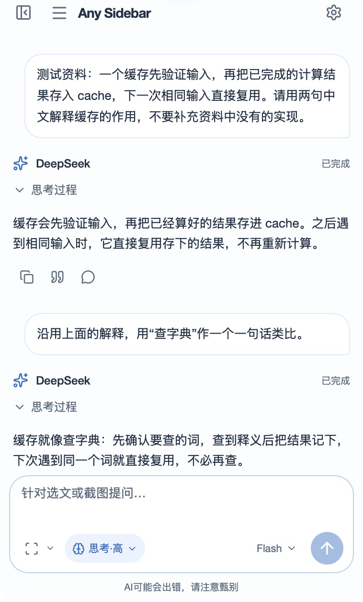
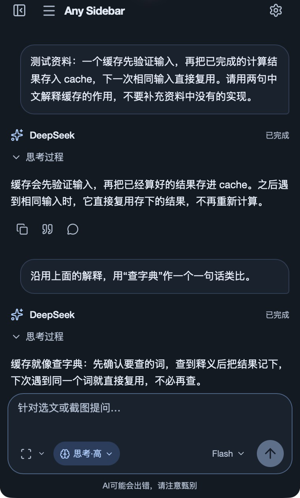

# Any Sidebar for Mac

一个轻量的 macOS AI 侧边栏，让对话留在正在阅读的文档旁。

通过桌面入口展开浮动侧边栏，划选文字或手动截取代码、公式和图表，带着资料直接问 AI，无需来回切换应用。

当前版本 **0.1.0，本机开发版**。面向 **Apple Silicon、macOS 14+**，自备 [DeepSeek API Key](https://platform.deepseek.com/)。软件免费，没有账号、会员或每日次数限制；API 用量由你的 DeepSeek 账户承担。

<p align="center">
  
  
</p>

亮暗主题下的连续对话。[查看全部 6 张界面截图](docs/macos/screenshots.md)，包括回答引用、会话抽屉和设置。

## 能做什么

- **划词提问**：从「预览」等阅读软件接收选中文字，自动加入引用，不主动弹出对话。
- **手动读屏**：框选区域或截取窗口，先加入草稿，再决定是否发送。也可以只发送图片。
- **按任务聊天**：手动新建和切换会话，同一会话可以讨论多份文档。
- **随手展开**：桌面入口、快捷键和菜单栏都能打开侧边栏；支持亮暗主题、字号和思考强度切换。

不自动读取整篇 PDF，不持续录屏。划词依赖阅读软件提供选区，扫描 PDF 或部分自绘阅读器可以改用截图。

## 安装

目前提供源码构建方式，尚未完成 Developer ID 签名和 Apple 公证。macOS 14 实机、双屏及完整图像理解流程仍待验证。

需要 Node.js 24.15+（24.x）或 26.x、npm，以及支持 Swift 6 的 Apple 开发工具。可通过 `xcode-select --install` 安装 Command Line Tools，用 `swift --version` 确认版本。

```sh
git clone https://github.com/decous37/Any-Sidebar-for-Mac.git
cd Any-Sidebar-for-Mac
npm ci
npx playwright install chromium
npm run build
npm run install:local
open ~/Applications/AnySidebarMac.app
```

Chromium 仅用于构建图标及界面测试，应用运行使用原生 WKWebView。安装脚本替换应用包，保留已有 Key、会话、截图和偏好。

## 开始阅读

1. 打开设置，保存自己的 API Key。
2. 需要自动划词时，确认采集说明并启用划词，在 macOS 系统设置中允许辅助功能。
3. 需要读屏时，允许屏幕访问。截图进入草稿后，点击发送才会提交给模型。
4. 左上角三横线打开会话抽屉，切换文件不会自动换会话。

| 默认快捷键 | 作用 |
| --- | --- |
| **⌘⇧A**（Command+Shift+A） | 开始框选读屏，再按一次取消 |
| **⌘⇧S**（Command+Shift+S） | 展开／收起对话浮窗 |

外部引用默认仅保留最新一段，可在设置切换为累积。

两项快捷键均可修改或清除。旧版默认 Shift+A、Shift+S 会升级，自定义及明确清除的绑定保留。

点击小助手或左上角收起按钮可隐藏面板；右键小助手还能打开设置、窗口读屏、隐藏入口和退出。收起后继续生成，退出则停止请求。

[完整使用指南](docs/macos/user-guide.md)

## 资料和 Key

选文、截图和对话保存在本机。发送、重试或重新生成时，相关资料及历史直接提交到 DeepSeek 官方 API，没有项目方中转、统计或云同步。

Key 保存在系统钥匙串；会话和图片位于 `~/Library/Application Support/com.decous.anysidebar.mac/`，文件没有额外加密。它们与 Chrome 版数据分开。

当前能力配置中 Flash 接收图像，Pro 只接收文字。文字提问和追问已实测，图像语义质量仍待真实模型端到端验证。AI 可能出错，请核对重要结论。

[隐私说明](apps/macos/resources/privacy.html)

## 本机签名与更新

默认构建使用临时签名，代码更新可能导致旧系统权限失效。如需固定本机身份，可主动运行：

```sh
node scripts/macos/setup-signing.mjs
npm run build
npm run install:local
```

此操作创建专用证书，私钥保留在用户钥匙串，只配置代码签名信任，不改变系统允许的软件来源。后续构建沿用同一身份；更换身份后可能需要重新授权并重启。固定签名不等于 Apple 公证，也不保证系统永远不再要求确认。

更新前正常退出旧应用。安装目录保持 `~/Applications/AnySidebarMac.app`，不要将不同构建的包内容手动混合。

## 开发与反馈

```sh
npm run typecheck
npm run lint
npm run test:web
npm run test:native
npm run build
npm run package
```

构建结果在 `build/macos/AnySidebarMac.app`，本机归档在 `release/macos/`。归档命令会检查资源和签名，不会自动上传。

[开发说明](docs/development.md) · [参与贡献](CONTRIBUTING.md) · [更新记录](CHANGELOG.md) · [阅读评测样例](docs/macos/reading-evaluation.md)

遇到问题，欢迎到 [Issues](https://github.com/decous37/Any-Sidebar-for-Mac/issues)。请先隐藏 Key、私人文件和敏感截图。

本项目是 [Any Sidebar](https://github.com/decous37/Any-Sidebar) 的独立 Mac 版本，沿用其侧边栏对话设计。采用 [MIT 许可证](LICENSE)，第三方许可见 [THIRD_PARTY_NOTICES.txt](THIRD_PARTY_NOTICES.txt)。与 DeepSeek 和 Apple 没有官方关联。
