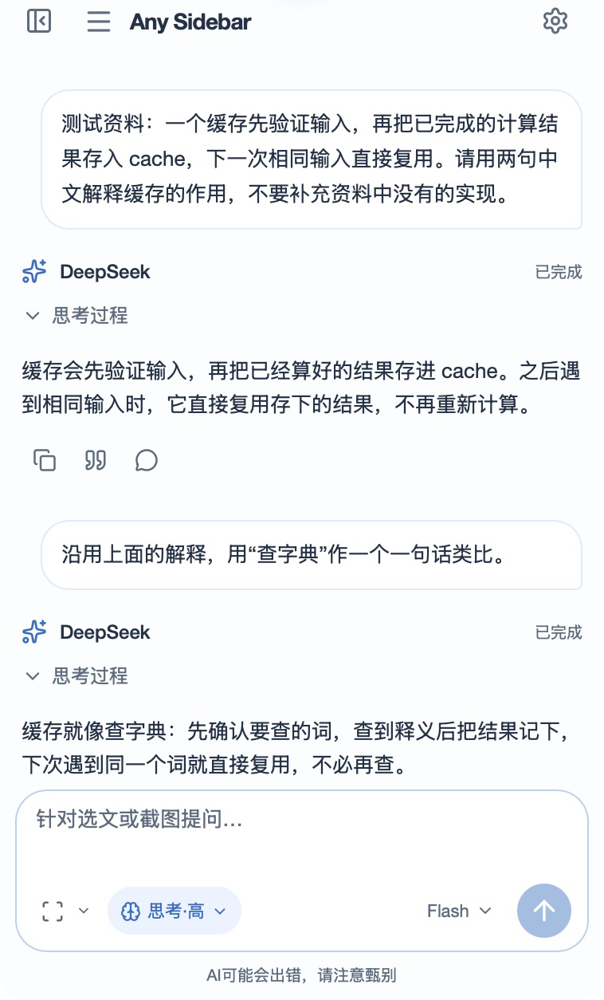
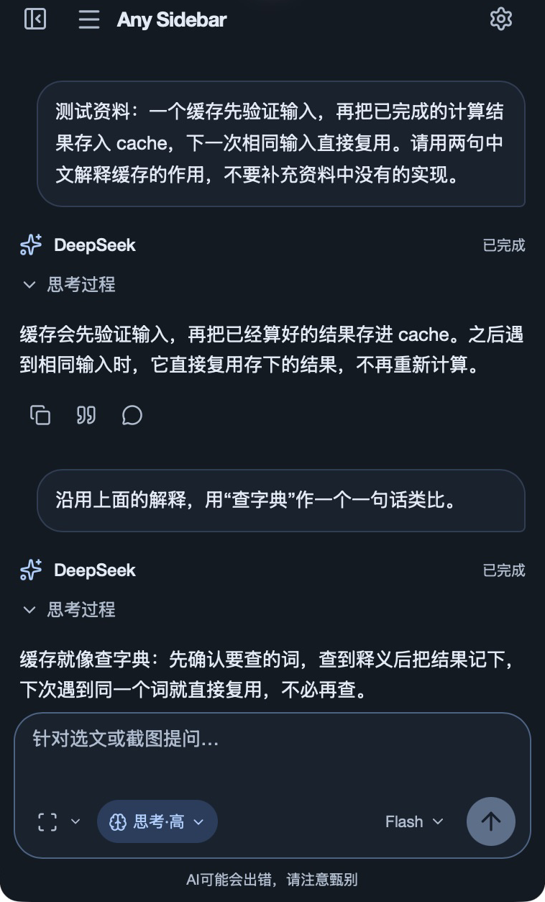
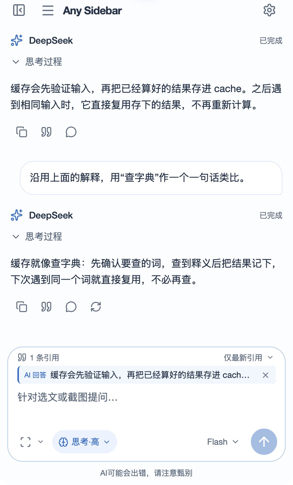
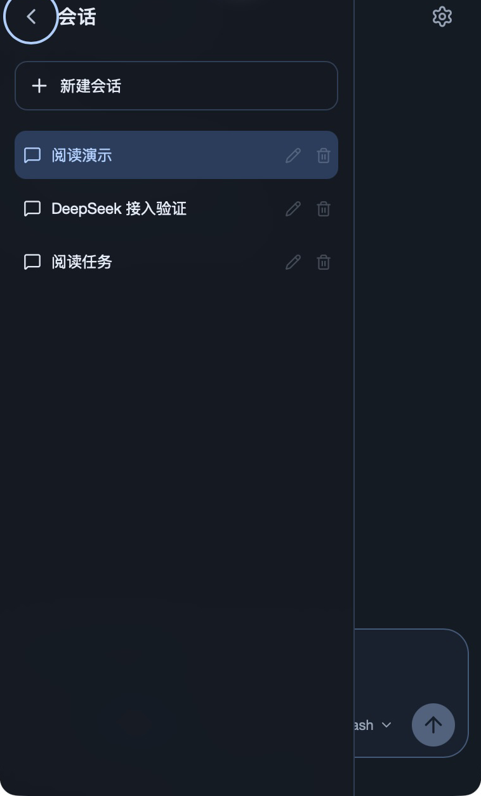
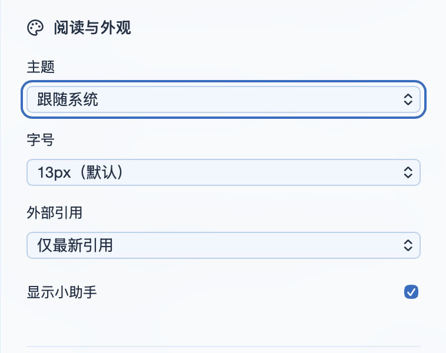
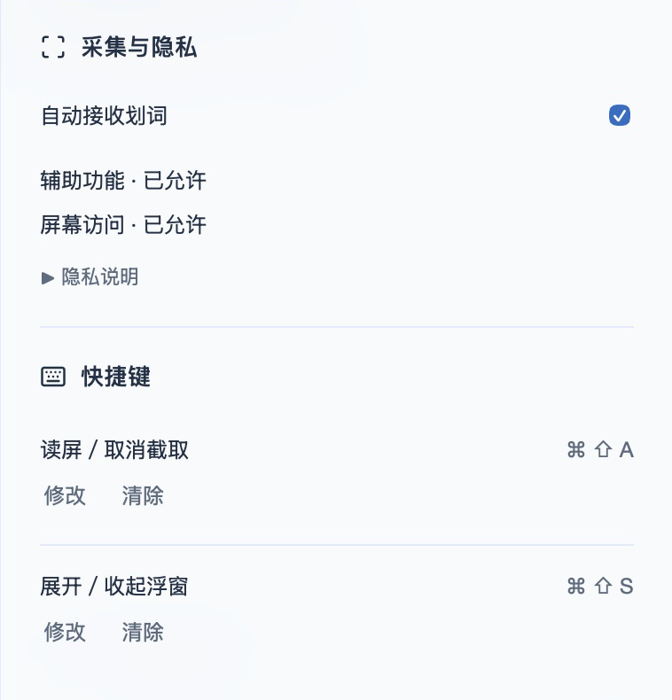

# Mac 界面一览

把对话放在阅读资料旁边。下面是实际应用中的六张截图，可以先看看日常使用时的样子。

## 对话与亮暗主题

继续追问同一段资料，也可以换一种说法理解。主题支持亮色、暗色和跟随系统。

  
  

## 把回答带进下一次提问

点击回答下方的“引用”，把它留在输入区，接着问。AI 回答引用独立保留一条。

## 按阅读任务切换会话

左上角打开会话抽屉。同一个任务可以讨论多份资料，切换文件不会自动另开对话。

## 调整阅读习惯

主题、字号和引用方式集中在“阅读与外观”中。外部引用默认只保留最新一段，也可以改成累积。

## 权限与快捷键

辅助功能用于接收选文，屏幕访问用于手动读屏。两项快捷键可分别修改或清除。

## 图片说明

图片于 2026-11-10 截取自已安装的 0.1.0，环境为 Apple Silicon / macOS 26.4.1。对话使用先前的公开缓存测试记录；本次没有新增模型请求，也没有改写回答。

图片仅裁剪显示范围并转换格式，没有包含 API Key 或私人文档。展示暗色后已恢复原来的“跟随系统”主题。

[安装和项目说明](../../README.md) · [完整使用指南](user-guide.md)
